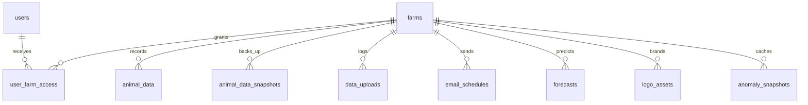

# Supabase database

This is the client livestock dashboard. The site is meant to stay available all the time. Supabase is the hosted PostgreSQL database behind it.

You will be given `backend/.env`. That file is your access. The Supabase account email stays with the client (or whoever created the project). You cannot open the Supabase dashboard, reset the database password, change the plan, resume a paused project, or download a backup from the website. You connect with the `DATABASE_URL` in `.env` and run SQL as that database role.

Do not commit `.env`, paste it into chat, or copy it into the frontend.

---

## How the pieces fit

```
Browser  →  Vercel (static pages + FastAPI)
                │
                │  DATABASE_URL  (Postgres, SSL, pooler port 6543)
                ▼
           Supabase PostgreSQL
```

The browser never calls Supabase. Login is a row in `users` plus a JWT signed with `JWT_SECRET` from `.env`. Farm permissions are rows in `user_farm_access`, checked in Python.

| In `.env` | What it is |
|-----------|------------|
| `DATABASE_URL` | The live database. Same value the Vercel app uses. |
| `DATABASE_BACKEND` | Set to `postgres` when you run locally against this database. If it is missing, the app tries Postgres and, on failure, silently uses a local DuckDB file instead. |
| `JWT_SECRET` | Signs login tokens. It is an app secret, not stored in Supabase. It must match Vercel or tokens issued locally will not match production. |
| `EID_PSEUDONYM_KEY` | Masks animal IDs for non-admin users. Also an app secret, not a column in the database. Empty means every API call returns 503. Do not change it: every animal gets a new mask. |
| `CRON_SECRET` | Lets scheduled jobs call the API, including the daily database ping. |
| `SUPABASE_URL`, `SUPABASE_ANON_KEY`, `SUPABASE_SERVICE_ROLE_KEY` | Ignored by the current code. The app does not use Supabase Auth, the Data API, or Storage. |

---

## The connection string

`DATABASE_URL` looks like this:

```
postgresql://postgres.<project-ref>:<password>@<pooler-host>:6543/postgres
```

| Part | Meaning |
|------|---------|
| `postgres.<project-ref>` | Database user. The `<project-ref>` is the Supabase project id. |
| Host containing `pooler.supabase.com` | Connection pooler. `ap-southeast-2` in the host means Sydney. Use the host you were given. Do not invent another one. |
| Port `6543` | Transaction pooler. This is the URL the live Vercel app must keep. Many short-lived serverless instances share a small set of database connections. |
| Port `5432` on the pooler host | Session pooler. Use it only for a long one-off script if port 6543 drops a bulk load, then put 6543 back. |
| Port `5432` on `db.<project-ref>.supabase.co` | Direct connection. Often IPv6-only, so laptops and Vercel cannot rely on it. |
| Database name `postgres` | The only database this app uses. |

If the password contains `@`, `#`, `%`, `/`, or `?`, those characters are percent-encoded inside the URL (`@` is `%40`). The password stored by Supabase is the decoded value.

A local API started with this `.env` reads and writes the client database. Treat every script as production.

Check that you are on Postgres and on the host you expect (the password is not printed):

```bash
python3 -c "
import sys
from urllib.parse import urlparse
sys.path.insert(0, 'backend')
from app.config import get_settings
from app.db import get_active_engine
s = get_settings()
u = urlparse(s.database_url)
print(get_active_engine(), u.hostname, u.port)
"
```

You want `postgres`, a `pooler.supabase.com` host, and port `6543`. `duckdb` means the URL was not used. Fix that before any script that writes.

Open a SQL shell:

```bash
psql "$(python3 -c "import sys; sys.path.insert(0,'backend'); from app.config import get_settings; print(get_settings().database_url)")"
```

If the client reports that SSL is required, add `?sslmode=require` to `DATABASE_URL` in your local file and in Vercel together. Ask whoever holds the Vercel project to change the deployed value. Changing only your laptop does not change production.

---

## Staying up all the time

Two different things go quiet, and only one of them is the database.

| Check | Touches Postgres | What it keeps up |
|-------|------------------|------------------|
| `GET /api/health` | No | The Vercel function. A green health check can happen while the database is paused. |
| `GET /api/health/db?cron_secret=…` | Yes, `SELECT 1` | The Supabase project. This is the database heartbeat. |

A free Supabase project pauses after about seven days with no queries. The deployed site schedules that heartbeat once a day. Schedules and the public URL are in [CRONJOB.md](CRONJOB.md). The secret is `CRON_SECRET` in your `.env`.

Confirm the heartbeat yourself:

```bash
curl -sS "https://<deployed-host>/api/health/db?cron_secret=<CRON_SECRET>"
```

`{"status":"ok","database":"up"}` means Postgres accepted a connection. `401` means the secret does not match Vercel. `503` means the database did not answer.

If the project is paused, connections fail until someone signed into Supabase clicks **Resume**. You cannot do that from `.env`. Ask the account owner. After a resume, the first connection can take a minute.

For a client site that must stay up, ask the owner to confirm one of these and keep a record of the answer:

- The project is on a plan that does not pause for inactivity, or
- The daily `/api/health/db` job is still scheduled and returning `database: up`.

If that job is deleted, or `CRON_SECRET` on Vercel changes and the scheduler is not updated, a free project can pause within a week and the dashboard stays down until the owner resumes it. Pausing does not delete data.

Switching production `DATABASE_URL` to port `5432` (direct) will exhaust the connection limit once visitors and the cron jobs overlap. Leave production on port `6543`.

---

## What is stored

`database/001_schema.sql` is the base schema. Three more tables are created by the app on first use. The role in `DATABASE_URL` is allowed to create them.



### `farms`

One row per client site (tenant).

| Column | Notes |
|--------|--------|
| `farm_id` | Primary key. Short code used everywhere else (`KF`, `WOW`). Also the prefix of CSV upload names. |
| `farm_name` | Label in the UI. |
| `slug` | Unique. |
| `is_active` | Inactive farms disappear from the farm list. |

Seeded tenants:

| `farm_id` | Name | Who can open it |
|-----------|------|-----------------|
| `KF` | Killara Feedlot | Every active user with a `user_farm_access` row |
| `WOW` | WOW Feedlot Killara | Admin accounts only, in the original seed |

### `users`

Application accounts. These are not Supabase Auth users. There is no email-and-password user in the Supabase dashboard to edit.

| Column | Notes |
|--------|--------|
| `id` | Integer primary key. This is the JWT `sub`. |
| `username` | Unique login name. |
| `password_hash` | scrypt hash. You cannot read the password back. |
| `is_admin` | Admin sees real animal IDs, uploads, and (when granted) WOW. |
| `is_active` | Inactive users cannot log in. |

The schema file inserts `F12_04`, `owner`, and `user` with placeholder hashes that cannot log in. `scripts/seed.py` adds `admin`, `owner`, and `user` with real hashes. On the live database, trust the table, not this paragraph:

```sql
SELECT id, username, is_admin, is_active,
       password_hash NOT LIKE '$scrypt$placeholder%' AS can_log_in
FROM users
ORDER BY id;
```

Login passwords belong to the client. Ask them for a user. Do not run `scripts/seed.py` against this database to “see if it works”: it overwrites the `admin`, `owner`, and `user` passwords with the defaults in that file, and it can delete and reload every `KF` animal row.

### `user_farm_access`

| Column | Notes |
|--------|--------|
| `user_id` | References `users.id`. Deleted with the user. |
| `farm_id` | References `farms.farm_id`. Deleted with the farm. |

Primary key is `(user_id, farm_id)`. The API returns only farms in this table for that user (`backend/app/db.py`, `get_user_farms`). A missing row looks like an empty dashboard, not a SQL error.

### `animal_data`

One measurement per animal per day. This is the large table.

Primary key `id`. Unique `(farm_id, eid, date)`.

Identifiers and categories: `farm_id`, `eid`, `date`, `breed`, `treatment`, `mob`, `sex`.

Measures (all nullable doubles): `weight`, `pweight`, `growthpbs`, `finalpweight`, `finalgrowthpbs`, `finaldailygrowth`, `feedintakekgd`, `feedintakepct`, `methane`, `animalvalue`, `animalprod`, `feedintakekgdsum`, `finalgrowthpbssum`, `animalprodsum`, `methanesum`, `methanesupplsum`, `carcassweight`, `dressedcarcass`.

Indexes exist for farm plus date, EID, breed, treatment, mob, sex, and year.

`KF` is loaded from `Data.csv` by `scripts/seed.py`. `WOW` is loaded from `Data2.xlsx` by `scripts/import_data2.py`. After go-live, new rows are supposed to arrive through the admin CSV upload, which also refreshes that farm’s forecasts.

### `animal_data_snapshots` and `data_uploads`

Written by an admin upload.

- `animal_data_snapshots`: `farm_id`, `snapshot_name`, `record_count`, optional `storage_path`, `created_by`, `created_at`. This is a record that a backup was taken. It is not a restorable copy of the whole database.
- `data_uploads`: file name, rows inserted / skipped / overwritten, `duplicate_mode` (`skip` or `overwrite`), `uploaded_by`.

`storage_path` is unused. The app does not store CSV files in Supabase Storage.

### `email_schedules`

Scheduled report emails for a farm.

`frequency` is `daily`, `weekly`, `monthly`, or `once`. Weekly uses `day_of_week` (1 = Monday). Monthly uses `day_of_month`. `once` uses `send_date`. `next_send_at` is when the cron worker will send. `report_filters` is JSON. `report_charts` is a text array. `report_format` is `PDF`, `HTML`, or `PRINT_HTML`.

The worker is `GET /api/email/process-due` with `CRON_SECRET`. With `EMAIL_DRY_RUN=true` it records the send and does not deliver mail. Mail credentials (`SMTP_*` or Resend) live in `.env`, not in this table.

### `forecasts` (created on first prediction refresh)

182-day final-weight forecasts for the Prediction page. Replaced for one farm on each refresh.

Primary key `(farm_id, eid, target, date)`.

Other columns: `pred`, `horizon`, `tier`, `history_days`, `data_through`, `model_version`, `validated_days`, `generated_at`. `target` is `finalpweight`.

Created by `backend/app/services/forecast_service.py` (`CREATE TABLE IF NOT EXISTS` plus `validated_days` if an older table lacks it). An admin upload refreshes the farm. You can refresh without an upload:

```bash
python scripts/forecast_job.py --farm KF --dry-run
python scripts/forecast_job.py --farm KF
```

`--dry-run` prints the database host and writes nothing. Omit it only when you intend to replace that farm’s forecast rows on the client database.

### `logo_assets` (created on first logo read or seed)

Header images, stored as bytes. Not Supabase Storage.

Primary key `(farm_id, filename)`. Columns: `content_type`, `data` (`BYTEA`). Farm id `default` holds the partner marks used when a farm has no logo of its own. The API serves them at `/api/farms/{farm_id}/logos/file/{filename}`. Files under `frontend/assets/logos/` are the disk fallback and the source `seed.py` copies in.

### `anomaly_snapshots` (created on first anomaly warm or analyze)

Cached anomaly results so a cold server can answer without recomputing.

Primary key `(farm_id, weight_col, sensitivity, year, month, day)`. `payload` is JSON text. `computed_at` is when it was built.

The frequent cron `GET /api/anomalies/warm` fills this table. Details are in [CRONJOB.md](CRONJOB.md). Deleting rows only makes the next analyze slow. It does not remove animal records.

---

## Row Level Security

`farms` and `animal_data` have Row Level Security enabled and no policies. Your `DATABASE_URL` role owns the tables, so your queries and the API bypass those policies. That is how the app is designed to run.

The Supabase Data API (`anon` key) does not bypass RLS, so it sees no rows. The frontend does not use that API. Leave it unused.

There is no per-user Postgres role. Adding a policy does not change what the API returns. Hiding a farm from a person is a change to `user_farm_access` or `users.is_active`.

---

## Looking at the live database

Run this in `psql` or the SQL editor if the owner runs it for you.

```sql
SELECT farm_id, farm_name, is_active FROM farms ORDER BY farm_id;

SELECT u.username, u.is_admin, u.is_active, a.farm_id
FROM users u
LEFT JOIN user_farm_access a ON a.user_id = u.id
ORDER BY u.username, a.farm_id;

SELECT farm_id, COUNT(*) AS rows, MIN(date) AS first_day, MAX(date) AS last_day
FROM animal_data
GROUP BY farm_id
ORDER BY farm_id;

SELECT table_name
FROM information_schema.tables
WHERE table_schema = 'public'
ORDER BY table_name;
```

`forecasts`, `logo_assets`, or `anomaly_snapshots` missing from that list means that feature has not run yet on this database. The next successful write creates the table.

From the repo, without printing secrets:

```bash
python3 -c "
import sys
sys.path.insert(0, 'backend')
from app.db import fetch_all
for row in fetch_all(\"SELECT farm_id, COUNT(*) AS n FROM animal_data GROUP BY farm_id ORDER BY farm_id\"):
    print(row)
"
```

---

## Changes you can make

You are connected as the table owner. A `DROP` or a bad `DELETE` is permanent unless the account owner still has a backup. Ask the owner to confirm a backup before you delete animal rows, drop a table, or reload a farm.

Safe, ordinary work:

| Task | How |
|------|-----|
| See who can open a farm | `SELECT` on `users` and `user_farm_access` above. |
| Give an existing user another farm | `INSERT INTO user_farm_access (user_id, farm_id) VALUES (…, …);` |
| Remove access | `DELETE` that one `user_farm_access` row. |
| Disable a login | `UPDATE users SET is_active = FALSE WHERE username = '…';` |
| Add a farm | `INSERT INTO farms (farm_id, farm_name, slug) VALUES (…);` then grant `user_farm_access`. Load animals with the admin CSV upload, not by editing rows by hand. `farm_id` must match the filename prefix (`KF_2026-10-20.csv`). |
| Add a column the app needs before it boots | Apply an `ALTER TABLE` with `psql` against `DATABASE_URL`. Put the same SQL in a new file under `database/`. Do not re-run `001_schema.sql` (it will fail on `CREATE TABLE`, and the `INSERT`s assume an empty database). Update `scripts/init_duckdb.py` if other people still use local DuckDB. |
| Add a table the app can create | Follow `forecasts`: `CREATE TABLE IF NOT EXISTS` on the write path, valid in Postgres and DuckDB. |
| New password for a user | Use `PUT /api/auth/password` while logged in as that user, or update `password_hash` with a scrypt hash from `app.auth.passwords.hash_password`. |

`scripts/import_data2.py` deletes and reloads every `WOW` row when the count does not match the workbook. Same rule as the seed script: run it only when the client has asked for that reload.

Schema changes have to be applied to the live database. Shipping the SQL file in git does not change Supabase. There is no migration runner.

---

## What to ask the account owner

You cannot do these with `.env`. Send the symptom and the time it started.

| Situation | Owner action |
|-----------|----------------|
| `/api/health` is ok and `/api/health/db` is 503, or local connections time out for hours | Open Supabase and resume the project if it is paused. Confirm the plan, or confirm the daily heartbeat is still scheduled. |
| `password authentication failed` after nobody changed `.env` | The database password was rotated. They set a new `DATABASE_URL` in Vercel and send you a new `.env`. Your old file will not start working on its own. |
| Need a point-in-time restore or a lost `animal_data` load | Restore from Supabase backups. `animal_data_snapshots` cannot do that. |
| Move region, upgrade, delete the project, or change network restrictions | Dashboard only. |
| Production env and your `.env` disagree | They control Vercel. You only have the file you were sent. |

Agree one shared `EID_PSEUDONYM_KEY` and do not rotate it after users have seen masked IDs.

---

## A new empty database

Only if the owner creates a new Supabase project and sends a new `DATABASE_URL`. You still apply the schema yourself:

```bash
psql "$(python3 -c "import sys; sys.path.insert(0,'backend'); from app.config import get_settings; print(get_settings().database_url)")" \
  -v ON_ERROR_STOP=1 \
  -f database/001_schema.sql
```

Then load data only the way the client asked (seed script, `import_data2.py`, or CSV upload). Set `DATABASE_BACKEND=postgres` first. Put the transaction-pooler URL (port 6543) into Vercel. Ask the owner to keep the daily `/api/health/db` job, and to keep the project on a plan that matches a 24/7 site.

---

## When the site cannot reach the database

| What you see | What it means |
|--------------|----------------|
| `/api/health` ok, login 500/503, `/api/health/db` 503 | Vercel is up and Postgres is not. Paused project, bad `DATABASE_URL`, or network block. You can test the same URL from your laptop. Resume and password resets go to the owner. |
| Laptop says `duckdb` in the host check | Local fallback. Production was not updated. Set `DATABASE_BACKEND=postgres`. |
| `password authentication failed` | Password in the URL does not match Supabase, or a special character was encoded twice. Owner confirms or resets the password. |
| `Tenant or user not found` | User must be `postgres.<project-ref>` on the pooler. Direct-connection user `postgres` on the pooler host will fail this way. |
| Timeout on `db.<project-ref>.supabase.co` | Direct host is not reachable from this network. Use the pooler host already in `.env`. |
| Works locally, fails on Vercel | Vercel `DATABASE_URL`, `JWT_SECRET`, or `EID_PSEUDONYM_KEY` differs from the file you have. Owner compares Vercel. |
| Login 401 for a password the client says is correct | Hash in `users` does not match. Confirm `can_log_in` in the query above. A placeholder hash never matches. Reset that one hash. Do not re-seed the farm. |
| User signs in and sees no animals | No `user_farm_access` for that farm, or the farm is inactive. Data can still be in `animal_data`. |
| `too many connections` | Production URL is not the transaction pooler. Put port 6543 back. |
| Forecast or anomaly table missing after a deploy | First write creates it. If the write says permission denied, the role in `DATABASE_URL` is no longer the owner. That is an owner-side change. |

---

## Related docs

- [CRONJOB.md](CRONJOB.md) — heartbeat, email worker, anomaly cache
- [VERCEL_DEPLOYMENT.md](VERCEL_DEPLOYMENT.md) — where production env vars live
- [README.md](README.md) — local run and default logins
- [database/001_schema.sql](database/001_schema.sql) — base tables
